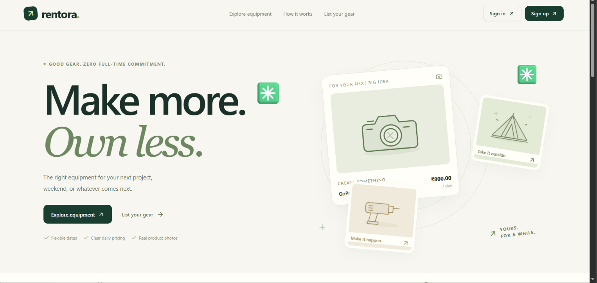
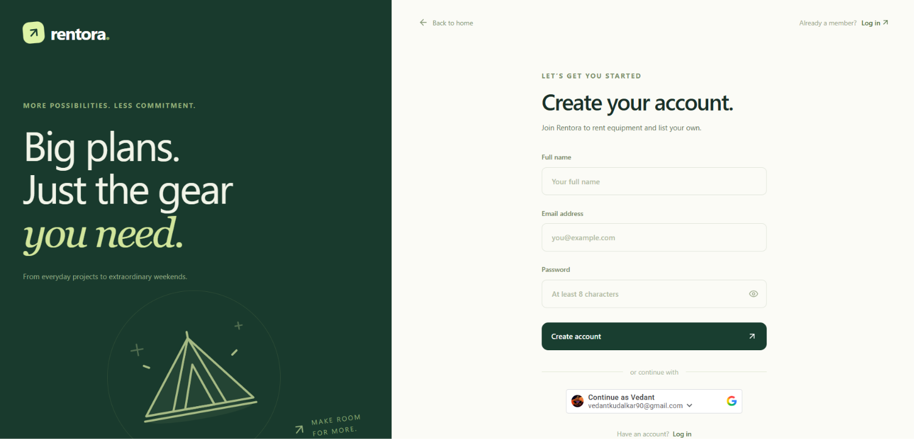
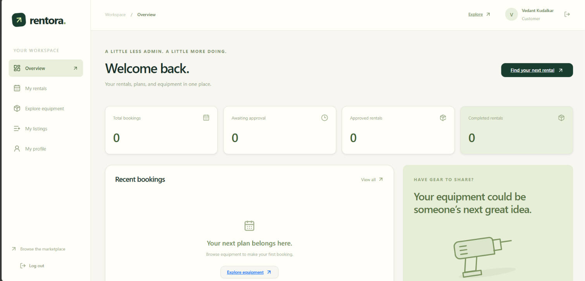
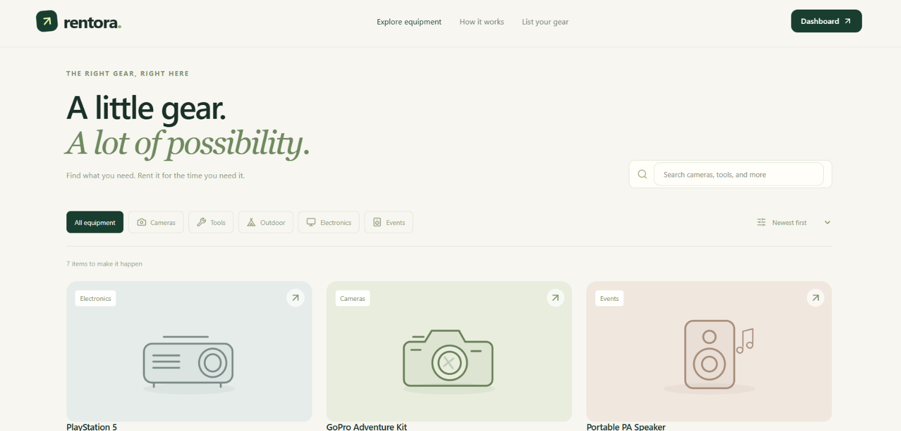
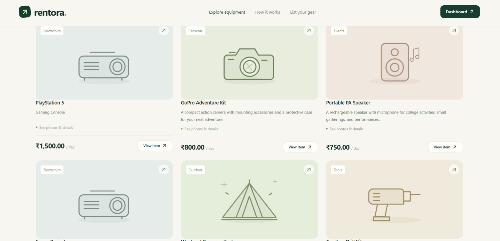
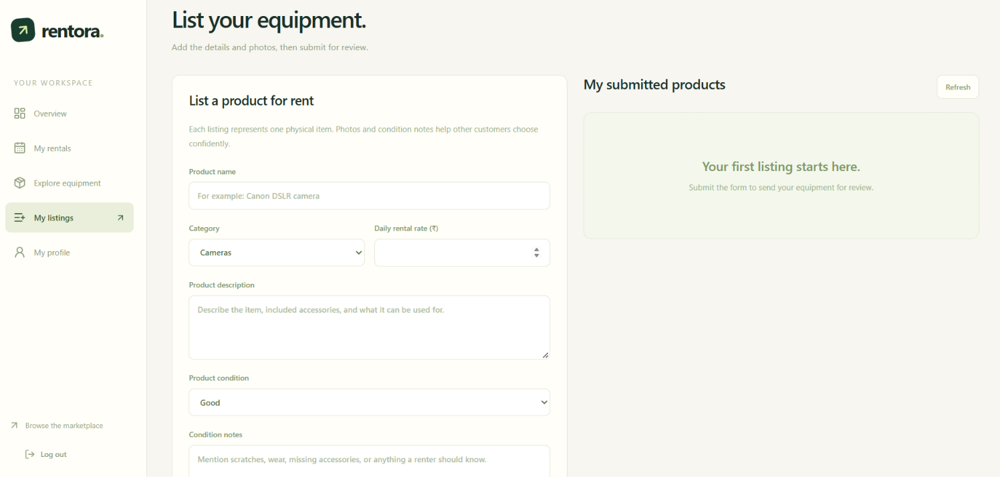
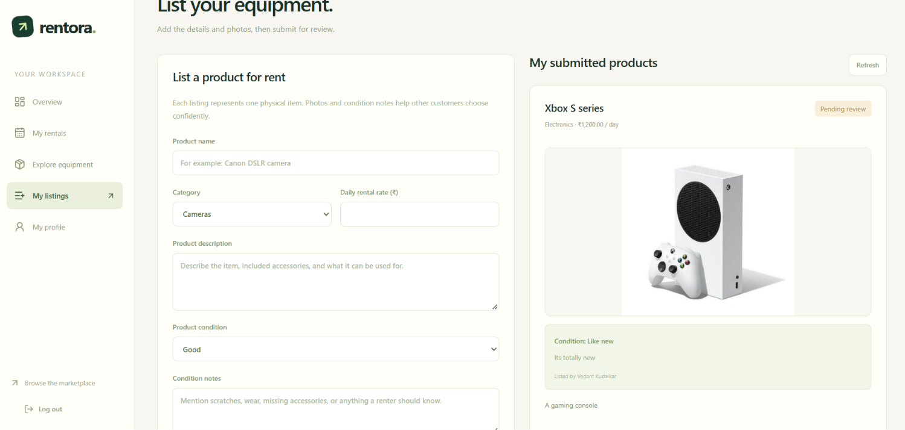
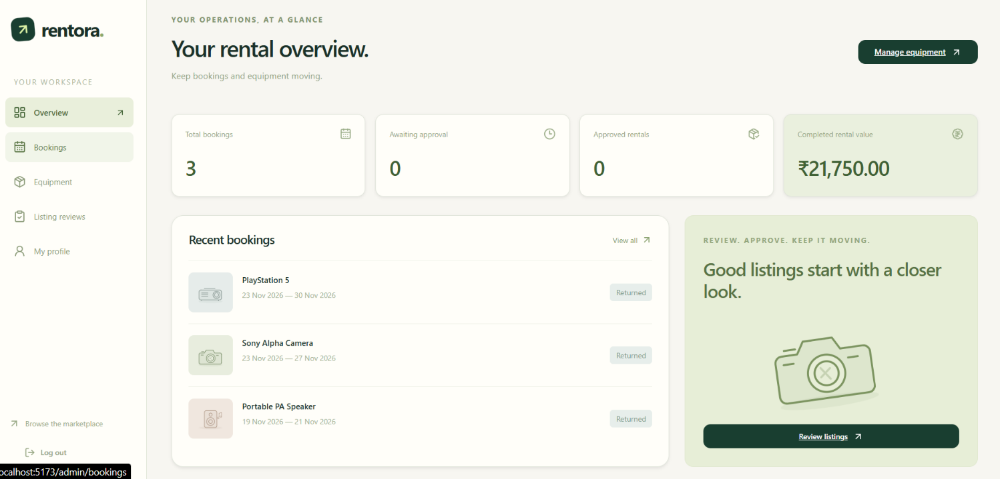
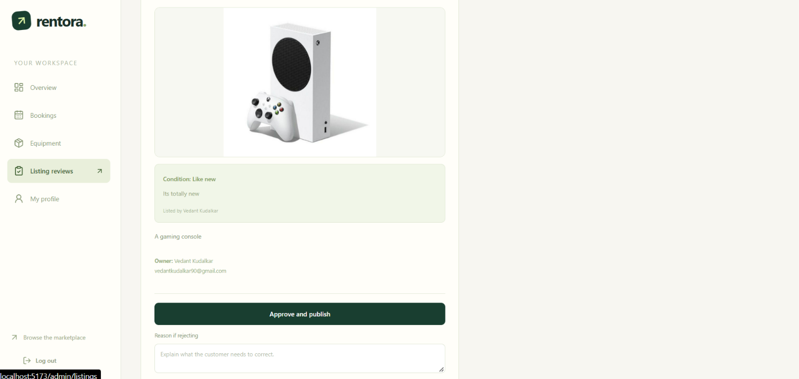
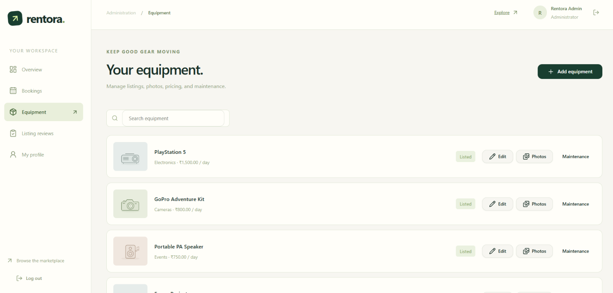

# Rentora — Equipment Rental Platform

Rentora lets customers browse equipment, reserve dates, and track rentals. Administrators manage equipment, approve or reject requests, and record returns with automatically calculated late fees.

## Screenshots

Explore Rentora’s customer and admin interfaces, from browsing equipment to reviewing listings.

### Landing page



### Create an account and Google sign-in



### Customer dashboard



### Equipment marketplace and filters



### Equipment catalogue and daily pricing



### Create an equipment listing



### Submitted listing with product photo



### Admin rental overview



### Admin listing review



### Admin equipment management



## Stack

React 19, Vite 7, HTML, CSS, JavaScript; Java 21, Spring Boot 3.5, Spring Security, Spring Data JPA; MySQL. No paid service or API key is required.

## Run on Windows: 3 steps

1. Extract the downloaded archive. Inside `Rentora`, you should see `backend`, `frontend`, and this README. Open this folder in VS Code. Start your local MySQL server.
2. Open a PowerShell terminal in `backend`. Run:

```powershell
java -version
javac -version
$env:DB_USERNAME = "root"
$dbPassword = Read-Host "MySQL password" -AsSecureString
$env:DB_PASSWORD = [System.Net.NetworkCredential]::new("", $dbPassword).Password
.\mvnw.cmd spring-boot:run
```

Keep the terminal running. Wait for `Started RentoraApplication`. The wrapper downloads Maven and dependencies on the first run. The MySQL database `rentora` and its tables are created automatically if your database account has permission. Your MySQL password stays in the current terminal environment and is not written into source files.

3. Open a SECOND terminal in `frontend`:

```powershell
node -v
npm -v
npm install
npm run dev
```

Open **http://localhost:5173** in your browser. Use this frontend address when signing in; the Vite proxy forwards API requests to Spring Boot. Keep both terminals open. Use Ctrl+C in each terminal to stop the application. Future runs need only the backend command (with the password environment variable set in that terminal) and `npm run dev` for the frontend.

Use JDK 21 (both `java` and `javac`), and Node.js 20.19+, 22.12+, or a current compatible LTS release. If `JAVA_HOME` points at a different Java version, set it to your installed JDK 21 directory before starting the backend.

## Demo accounts

| Account | Email | Password |
| --- | --- | --- |
| Admin | admin@rentora.local | Admin@123 |
| Customer | user@rentora.local | User@1234 |

These accounts and six sample items are created on first startup. New registrations always receive the CUSTOMER role. The admin seed checks its email before creating an account. Sample data is inserted only when the equipment table is empty; restarts preserve your changes.

A historical, approved PA Speaker rental is seeded for the demo customer. It ended two days before the first startup date. This lets you demonstrate overdue fee calculation immediately. Label it as demo data in your presentation. You can return it through the admin account. Do not clear your database just to recreate it.

## Suggested 5-minute presentation

1. Open the catalogue. Explain search, categories, daily rates, and date-based availability.
2. Register a new customer account or sign in with the demo customer. Pick a camera and request a three-day rental. The amount is three times its daily rate.
3. Try the same equipment and overlapping dates again. The server refuses the second reservation. The last day is included in the first booking.
4. Log out, sign in as admin, and open Manage bookings. Approve the request; show the customer's name, dates, status, and charges.
5. Return the seeded, overdue PA Speaker rental using today's date. Explain the original rental amount, two overdue days, late fee, and final total.
6. Open Equipment manager. Add equipment, change its price, and demonstrate maintenance on an unreserved item. Existing bookings retain their original daily rate.
7. Sign in as the customer again. Show the approved booking, booking history, and cancellation action for an eligible booking.

If demonstrating both roles side by side, use a normal browser window for one role and a private/incognito window for the other. Tabs in the same browser session share the same login.

## Business rules

- One listing represents one physical item. Add separate listings for separate physical units.
- Both rental dates are included: Nov 23 to Nov 25 is three days; same-day rentals are one day.
- Rentals must start today or later, can last up to 90 days, and can start no more than one year ahead. Business dates use Asia/Kolkata.
- PENDING and APPROVED requests reserve their date ranges. Requests overlap when `existing.start <= requested.end` and `existing.end >= requested.start`.
- Booking creation acquires a database write lock on the equipment row before checking for overlaps. Concurrent booking requests for that item are serialized.
- A customer can cancel only their own pending/approved booking if its start date has not passed. Rejected, cancelled, and returned bookings cannot be cancelled again.
- Only admins can approve/reject pending bookings. Requests whose start date has passed cannot be approved.
- Only admins can record a return, and only for approved rentals. The return date must be between the rental start and today.
- Late fee = `max(0, actual return date - end date) × daily rate captured when booking`. Before return, approved overdue rentals display an estimate through today.
- Price changes apply to new bookings. Existing rental and late-fee calculations use the captured rate.
- Maintenance blocks new bookings. Upcoming reservations and outstanding approved rentals must be resolved before maintenance can be enabled.
- Early returns retain the originally booked rental amount. No automatic partial refund is calculated.
- Availability is based on booked date ranges. An overdue item may still have future reservations; a real rental business would also need handover and overdue rescheduling procedures.

## Application flow and file map

`React screen → fetch('/api/...') → Vite proxy → Spring Security → Controller → RentalService → JPA repository → MySQL → JSON response → React state`

| File | Responsibility |
| --- | --- |
| frontend/src/App.jsx | Catalogue, auth, booking, customer and admin screens |
| frontend/src/api.js | API requests, session cookies, and CSRF headers |
| frontend/src/EquipmentArt.jsx | Local SVG equipment illustrations |
| frontend/src/styles.css | Responsive green and ivory interface |
| frontend/vite.config.js | React setup and development API proxy |
| backend/pom.xml | Spring Boot dependencies and Maven build |
| backend/src/main/resources/application.properties | MySQL, session, port, demo configuration |
| backend/src/main/java/com/rentora/RentoraApplication.java | Spring Boot entry point and India business clock |
| backend/src/main/java/com/rentora/SecurityConfig.java | Access rules, session security, and CSRF protection |
| backend/src/main/java/com/rentora/AuthController.java | Register, sign in, current account, sign out |
| backend/src/main/java/com/rentora/EquipmentController.java | Equipment and availability endpoints |
| backend/src/main/java/com/rentora/BookingController.java | Customer and admin booking endpoints |
| backend/src/main/java/com/rentora/RentalService.java | Dates, reservations, status transitions, pricing, returns |
| backend/src/main/java/com/rentora/Dto.java | Validated request records and safe response records |
| backend/src/main/java/com/rentora/UserAccount.java | User entity and roles |
| backend/src/main/java/com/rentora/Equipment.java | Physical equipment entity |
| backend/src/main/java/com/rentora/Booking.java | Booking entity and statuses |
| backend/src/main/java/com/rentora/*Repository.java | Database access and booking conflict query |
| backend/src/main/java/com/rentora/SeedData.java | Demo accounts, equipment, historical overdue booking |
| backend/src/main/java/com/rentora/ApiErrors.java | Validation and error responses |
| backend/src/test/java/com/rentora/RentoraIntegrationTest.java | Security, workflow, fees, and concurrency tests |

The backend classes share the `com.rentora` package, and entity fields use package visibility to keep the first version small. Controllers return DTO records rather than JPA entities, so password hashes and persistence details are excluded from API responses.

## API routes

| Method | Route | Access |
| --- | --- | --- |
| GET | /api/auth/csrf | Public, creates a CSRF token and session |
| POST | /api/auth/register | Public, CSRF header required |
| POST | /api/auth/login | Public, CSRF header required |
| GET | /api/auth/me | Signed-in user |
| POST | /api/auth/logout | Signed-in user, CSRF header required |
| GET | /api/equipment | Public |
| GET | /api/equipment/{id}/availability?start=YYYY-MM-DD&end=YYYY-MM-DD | Public |
| POST | /api/bookings | Customer |
| GET | /api/bookings/mine | Signed-in user, own bookings only |
| PATCH | /api/bookings/{id}/cancel | Booking owner |
| GET | /api/admin/bookings | Admin |
| PATCH | /api/admin/bookings/{id}/approve | Admin |
| PATCH | /api/admin/bookings/{id}/reject | Admin |
| PATCH | /api/admin/bookings/{id}/return | Admin |
| POST | /api/admin/equipment | Admin |
| PUT | /api/admin/equipment/{id} | Admin |
| PATCH | /api/admin/equipment/{id}/active | Admin |

Every POST, PUT, and PATCH requires the CSRF header returned by `/api/auth/csrf`, along with the session cookie. The React API helper does this automatically. Passwords are hashed with BCrypt. Login rotates the session ID. The browser stores the session in an HttpOnly cookie; no password or auth token is saved in localStorage. Sessions expire after two hours of inactivity.

## Configuration

Set these environment variables in the backend terminal when needed:

| Variable | Default | Purpose |
| --- | --- | --- |
| DB_USERNAME | root | Your MySQL account |
| DB_PASSWORD | empty | Your MySQL password |
| DB_URL | jdbc:mysql://localhost:3306/rentora?createDatabaseIfNotExist=true&serverTimezone=Asia/Kolkata | Database host, port, and schema |
| PORT | 8080 | Backend port; update Vite proxy if changed |
| SEED_DEMO | true | Demo customer, equipment, and historical booking |
| ADMIN_EMAIL | admin@rentora.local | Admin account created if absent |
| ADMIN_PASSWORD | Admin@123 | Password used only when the admin is first created |
| COOKIE_SECURE | false | Set true when serving through HTTPS |

Changing ADMIN_PASSWORD later does not overwrite an existing account's password. For shared deployment, use a new strong admin password before first startup, disable demo seeding, use HTTPS and secure cookies, and replace development schema updates with migrations. This package is configured for a local academic demo.

## Check and build

In `backend`:

```powershell
.\mvnw.cmd test
.\mvnw.cmd package
java -jar .\target\rentora-1.0.0.jar
```

Tests use an isolated H2 database in MySQL compatibility mode. They do not change your MySQL data. They cover public/private access, CSRF, hashed registration, role protection, login/logout, inclusive dates, overlapping bookings, cancellations, price snapshots, return fees, maintenance, and two concurrent attempts to reserve one item. H2 tests do not replace testing against your installed MySQL server.

In `frontend`:

```powershell
npm run build
npm run preview
```

Preview runs on http://localhost:4173 and still needs Spring Boot on port 8080. The default development server runs on port 5173. The built `dist` is not a complete deployment by itself; the API must also be hosted and proxied when deployed.

## Fix common startup problems

| Problem | Fix |
| --- | --- |
| `JAVA_HOME is not defined correctly` | Set JAVA_HOME to the installed JDK 21 folder, then reopen the terminal. `javac -version` should show 21. |
| `release version 21 not supported` | Maven is using an older JDK. Check `java -version`, `javac -version`, and `.\mvnw.cmd -v`. |
| `Access denied for user root` | Set DB_USERNAME and DB_PASSWORD in the same terminal that starts Spring Boot. Use your MySQL password, not the demo account password. |
| `Communications link failure` | Start the MySQL SERVER service and verify port 3306. The MySQL Configurator is a setup tool; the server service must also run. |
| `Public Key Retrieval is not allowed` | For this local-only demo, set DB_URL to `jdbc:mysql://localhost:3306/rentora?createDatabaseIfNotExist=true&serverTimezone=Asia/Kolkata&allowPublicKeyRetrieval=true&useSSL=false`. |
| Database creation denied | Run `database.sql` with an account allowed to create databases, then give your application account access to `rentora`. |
| Port 8080 already in use | Stop the other process, or change PORT and the proxy target in vite.config.js. |
| Port 5173 already in use | Stop the previous frontend terminal with Ctrl+C. Vite uses a fixed port to avoid switching unexpectedly. |
| npm.ps1 is blocked | Use `npm.cmd install` and `npm.cmd run dev` in PowerShell. |
| Maven download fails | Check internet access, then retry the wrapper. First startup downloads Maven and Java dependencies. |
| Backend is running but UI cannot connect | Open the frontend URL, keep both terminals running, and check the backend log for its startup status. |
| Security token expired | Refresh the frontend page and sign in again. Use one hostname consistently in your browser. |

## Submission scope and future work

Implemented: database-backed auth, customer/admin roles, catalogue search/categories, date availability, booking reservation, approval/rejection, owner cancellation, history, equipment creation/editing, maintenance, and return/late-fee calculation.

Future work: payment gateway and refunds, photo uploads, email notifications, pickup/handover workflow, stock quantities, maintenance date ranges, pagination, password reset, audit logs, database migrations, and deployment hardening. Current maintenance is an on/off status; it is not a dated maintenance schedule. There is no payment collection, delivery integration, or damage-deposit calculation in this version.

Reference documentation: [Spring Boot](https://docs.spring.io/spring-boot/3.5/), [Spring Security](https://docs.spring.io/spring-security/reference/), [React](https://react.dev/), [Vite](https://vite.dev/guide/), [MySQL](https://dev.mysql.com/doc/).
